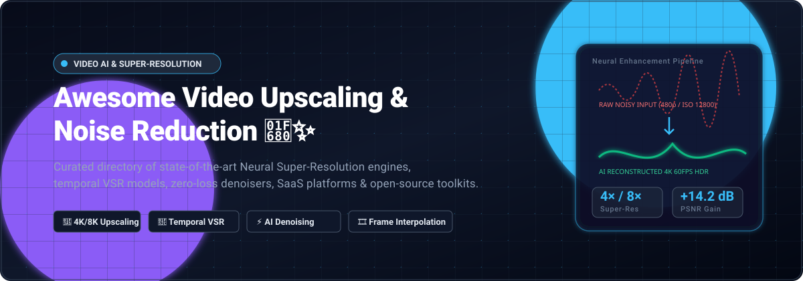

# 🎬 Awesome Video Upscaling & Noise Reduction 🚀✨

  <strong>Curated directory of state-of-the-art Neural Video Super-Resolution (VSR), AI Video Enhancement, Deep Learning Denoising, Temporal De-flickering, and Frame Interpolation Engines 🌟 Star if you like it! 🌟</strong>

*Last updated: November 2026*

---

## 📑 Table of Contents
- [📌 Overview & SEO Highlights](#-overview--seo-highlights)
- [📊 Sector Overview & Market Dynamics](#-sector-overview--market-dynamics)
- [🏢 SaaS & Hosted Video Enhancement Platforms](#-saas--hosted-video-enhancement-platforms)
- [💻 Open-Source Repositories & Neural Models](#-open-source-repositories--neural-models)
- [🤝 How to Contribute](#-how-to-contribute)
- [💖 Support & Sponsorship](#-support--sponsorship)
- [⭐ Star History](#-star-history)
- [⚖️ Disclaimer](#️-disclaimer)

---

## 📌 Overview & SEO Highlights

Welcome to the definitive developer and video engineering guide for **video upscaling**, **super-resolution (VSR)**, **AI video noise reduction**, **temporal consistency modeling**, and **cinematic restoration**. Whether you need production-grade cloud REST APIs to batch remaster archive footage to 4K/8K, self-hosted Docker containers running **Real-ESRGAN** and **GFPGAN**, real-time spatial upscalers for live streaming with **NVIDIA Maxine** or **VapourSynth**, or research architectures like **BasicVSR++**, **VRT**, and **SwinIR**, this index catalogs the industry's best SaaS tools and open-source models.

### 🔍 Key Discovery Keywords & Topics
`video-upscaling` • `noise-reduction` • `super-resolution` • `video-enhancement` • `deep-learning` • `vsr` • `frame-interpolation` • `real-esrgan` • `gfpgan` • `codeformer` • `rife` • `basicvsr` • `topaz-video-ai` • `runway-gen` • `vapoursynth` • `neural-denoiser` • `4k-remaster` • `ffmpeg-ai`

---

## 📊 Sector Overview & Market Dynamics

The global **AI Video Enhancement and Super-Resolution Sector** was valued at approximately **$2.1 Billion in 2024** and is projected to surpass **$7.8 Billion by 2030–2032**, expanding at a compound annual growth rate (CAGR) of **24.5%–28.0%**. Growth is catalyzed by surging demand for 4K/8K streaming, automated legacy video restoration in Hollywood and streaming OTT catalogs, real-time video conferencing enhancements, and UGC social media remastering.

The industry structure is **moderately fragmented and bifurcated**:
1. **Commercial Giants & Creative Suites**: At the enterprise tier, highly specialized video AI vendors (such as **Topaz Labs**, **Runway**, **Blackmagic DaVinci Neural Engine**, and **Adobe Sensei**) capture professional film and post-production studios with high willingness to pay.
2. **Open-Source & Self-Hosted Toolchains**: Highly distributed and innovation-driven. Academic and open-source models (**Real-ESRGAN**, **GFPGAN**, **CodeFormer**, **RIFE**, **BasicVSR++**) dominate developer pipelines, gaming emulator communities, self-hosted desktop tools (**Upscayl**, **chaiNNer**, **Video2X**), and custom production pipelines due to cost efficiency and offline data privacy.

---

## 🏢 SaaS & Hosted Video Enhancement Platforms

The following table catalogs premier hosted SaaS platforms and developer APIs for AI video upscaling, noise reduction, and video restoration, sorted by company valuation / market size (descending):

| Platform / Vendor | Company Size (Valuation / Revenue) | Starting Price (Strict Tier) | Free Tier Limits (Strict Terms) | Core Capabilities & Engine Highlights |
| :--- | :--- | :--- | :--- | :--- |
| **[Adobe Sensei / Premiere Pro](https://www.adobe.com/creativecloud/video.html)** | **$215 Billion** *(Market Cap / $21.5B+ Rev)* | $22.99 / month *(Single App Premiere Pro)* | 7-day free trial *(Full access to Premiere Pro & AI video enhancement tools)* | Enterprise AI video restoration, optical flow super-sampling, speech denoiser, and automated color/grain recovery. |
| **[NVIDIA Maxine Video Effects SDK](https://www.nvidia.com/en-us/geforce/broadcasting-app/)** | **$3.5 Trillion** *(Market Cap / $120B+ Rev)* | $0.00 / month *(Bundled free with RTX GPUs)* | 100% free with NVIDIA RTX 2060+ GPU hardware *(NVIDIA Broadcast app & developer SDK access)* | Real-time AI video noise removal, video super-resolution (up to 4K), virtual background, and eye contact tracking. |
| **[DaVinci Resolve Studio (Blackmagic)](https://www.blackmagicdesign.com/products/davinciresolve)** | **$850 Million** *(Est. Valuation / $450M+ Rev)* | $295.00 one-time *(Perpetual Studio license)* | Free forever version *(DaVinci Resolve standard edition with HD upscaling and core denoisers)* | DaVinci Neural Engine Super Scale (up to 4×), advanced temporal and spatial video noise reduction, de-flicker, and face refinement. |
| **[Runway Gen-3 / Video Tools](https://runwayml.com)** | **$4.0 Billion** *(Valuation / $100M+ ARR)* | $12.00 / user / month *(Standard plan, 625 credits/mo)* | Free forever plan: 125 one-time credits *(Max 3 video projects, 720p export cap)* | Generative video super-resolution, AI upscale up to 4K, motion brush, frame synthesis, and background noise cleanup. |
| **[Topaz Video AI](https://www.topazlabs.com/topaz-video-ai)** | **$350 Million** *(Est. Valuation / $60M+ Rev)* | $299.00 one-time *(1 year of upgrades included)* | 30-day free trial *(Unlimited preview renders with watermark; full local GPU export unlocked upon purchase)* | The industry standard desktop AI video upscaler: Artemis, Iris face restoration, Proteus custom tuning, Chronos 16× slow-motion, and Dione interlaced deinterlacer. |
| **[CapCut Pro / ByteDance](https://www.capcut.com)** | **$220 Billion** *(Parent ByteDance Valuation)* | $9.99 / month *(Pro subscription)* | Free forever tier *(Standard 1080p AI video denoise and smart upscale tools with CapCut watermark)* | ByteDance video enhancement models, instant noise cancellation, 4K HD upscaling, facial feature enhancement, and auto reframe. |
| **[HitPaw VikPea (Video Enhancer)](https://www.hitpaw.com/video-enhancer.html)** | **$50 Million** *(Est. Valuation)* | $42.99 / month *(or $139.99 lifetime)* | Free trial: 1 export with watermark *(Full preview of all AI models before export)* | Dedicated models for animation/anime upscale, face enhancement, low-light video recovery, and general denoise up to 8K. |
| **[Cutout.pro Video Enhancer](https://www.cutout.pro)** | **$20 Million** *(Est. Valuation)* | $5.00 / month *(for 40 credits)* | 5 free credits upon sign-up *(Process up to 15 seconds of low-res video upscaling to 1080p/4K)* | Cloud web API for video super-resolution, motion deblurring, temporal noise reduction, and video background removal. |
| **[AVCLabs Video Enhancer AI](https://www.avclabs.com/video-enhancer-ai.html)** | **$15 Million** *(Est. Valuation)* | $39.95 / month *(or $299.90 lifetime)* | Free trial: 3 watermarked video exports *(Max 3 minutes per export, all AI models enabled)* | Multi-frame temporal video super-resolution, facial detail recovery, anime upscaler, and automated grain suppression. |
| **[TensorPix AI](https://tensorpix.ai)** | **$8 Million** *(Est. Valuation)* | €11.00 / month *(for 50 compute credits)* | Free forever: 3 free credits upon sign-up *(Process up to 2 short video clips up to 1080p resolution)* | Web-based video upscaler and denoiser running 20+ specialized AI neural filters with cloud GPU acceleration. |

---

## 💻 Open-Source Repositories & Neural Models

Curated list of open-source video super-resolution architectures, deep learning denoisers, frame interpolators, and enhancement workbenches, sorted strictly by GitHub stars (descending):

| Project & Repository | Stars | Primary Focus & Architecture | Description & Core Capabilities |
| :--- | :--- | :--- | :--- |
| **[Upscayl](https://github.com/upscayl/upscayl)** |  | Cross-Platform Desktop GUI | Top open-source AI image and batch frame upscaler for Linux, macOS, and Windows powered by Vulkan NCNN and Real-ESRGAN. |
| **[GFPGAN](https://github.com/TencentARC/GFPGAN)** |  | Blind Face Restoration GAN | Tencent ARC's practical algorithm for restoring real-world degraded, blurred, and low-res faces in video streams and images. |
| **[Real-ESRGAN](https://github.com/xinntao/Real-ESRGAN)** |  | Practical General Video/Image SR | SOTA restoration model synthesizing realistic textures while removing compression noise and blur; supports video batch pipelines and anime models. |
| **[Waifu2x](https://github.com/nagadomi/waifu2x)** |  | 2D Anime Super-Resolution | The pioneering deep convolutional neural network for anime-style artwork upscale and noise reduction using 2-D ConvNet. |
| **[Video2X](https://github.com/k4yt3x/video2x)** |  | Lossless Video Upscaling Suite | High-performance automated video/GIF super-resolution framework integrating Waifu2x, Real-ESRGAN, SRMD, and RIFE frame interpolation. |
| **[CodeFormer](https://github.com/sczhou/CodeFormer)** |  | Transformer Face Restoration | Robust blind face restoration algorithm using a Discrete Codebook Prior for heavily compressed, noisy, and unaligned video frames. |
| **[Waifu2x-Extension-GUI](https://github.com/AaronFeng753/Waifu2x-Extension-GUI)** |  | Windows Video/Image Enhancer GUI | Comprehensive GUI supporting Real-ESRGAN, Real-CUGAN, Anime4K, and RIFE with multi-GPU batch video processing and automated frame interpolation. |
| **[FastPhotoStyle](https://github.com/NVIDIA/FastPhotoStyle)** |  | Photorealistic Style & Tone Transfer | NVIDIA's deep learning library for ultra-fast, photorealistic transfer of color and lighting across video sequences without artifacts. |
| **[BasicSR](https://github.com/XPixelGroup/BasicSR)** |  | Video & Image Restoration Toolbox | PyTorch open-source toolbox powering foundational super-resolution and video restoration models (EDVR, BasicVSR, Real-ESRGAN, NAFNet). |
| **[DAIN](https://github.com/baowenbo/DAIN)** |  | Depth-Aware Video Frame Interpolation | CVPR paper implementation synthesizing smooth 60fps/120fps video frames through explicit depth flow and pixel motion estimation. |
| **[MMEditing](https://github.com/open-mmlab/mmediting)** |  | OpenMMLab Image/Video Editing | Comprehensive multimodal toolbox for low-level video processing: super-resolution, video inpainting, matting, and denoising. |
| **[ESRGAN](https://github.com/xinntao/ESRGAN)** |  | Enhanced Residual SRGAN | PIRM Challenge champion network introducing Residual-in-Residual Dense Blocks (RRDB) for realistic perceptual super-resolution. |
| **[chaiNNer](https://github.com/chaiNNer-org/chaiNNer)** |  | Node-Based Neural Pipeline Workbench | Visual node graph editor for chaining PyTorch, NCNN, and ONNX video/image restoration models (ESRGAN, HAT, SwinIR, SCUNet). |
| **[RIFE (ECCV2022)](https://github.com/hzwer/arXiv2020-RIFE)** |  | Real-Time Intermediate Flow Estimation | Lightning-fast video frame interpolation algorithm capable of converting 24fps/30fps videos to 60fps/120fps with minimal GPU overhead. |
| **[SwinIR](https://github.com/JingyunLiang/SwinIR)** |  | Swin Transformer Image/Video Restoration | Classical, real-world, and raw deep image/video restoration model leveraging shift-window self-attention for artifact and noise removal. |
| **[KAIR](https://github.com/cszn/KAIR)** |  | PyTorch Image/Video Restoration Toolbox | High-performance repository hosting BSRGAN, DPIR, and RCAN for blind super-resolution, Gaussian denoising, and deblurring. |
| **[waifu2x-ncnn-vulkan](https://github.com/nihui/waifu2x-ncnn-vulkan)** |  | High-Speed Vulkan Neural Engine | Ultra-fast C++ and Vulkan NCNN port of Waifu2x running locally on Intel, AMD, and NVIDIA consumer graphics chips without CUDA. |
| **[NAFNet](https://github.com/megvii-research/NAFNet)** |  | Nonlinear Activation-Free Network | SOTA image and video restoration baseline achieving breakthrough denoising and deblurring benchmark scores without nonlinear activations. |
| **[EDVR](https://github.com/xinntao/EDVR)** |  | Video Restoration with PCD Alignment | Winning solution in NTIRE 2019 for video super-resolution and deblurring with pyramid, cascading, and deformable convolutions. |
| **[VRT (Video Restoration Transformer)](https://github.com/JingyunLiang/VRT)** |  | Video Restoration Transformer | Pioneering transformer framework modeling long-range temporal dependencies across multiple frames for joint video super-resolution and denoising. |
| **[BSRGAN](https://github.com/cszn/BSRGAN)** |  | Practical Degradation SR | Deep blind super-resolution framework modeling complex camera sensor noise, JPEG compression, and lens blur for realistic video frames. |
| **[Practical-RIFE](https://github.com/hzwer/Practical-RIFE)** |  | Practical Video Frame Interpolation | Lightweight production implementation of RIFE tailored for real-world video interpolation pipelines and streaming rendering. |
| **[havsfunc](https://github.com/HomeOfVapourSynthEvolution/havsfunc)** |  | VapourSynth Video Processing Library | Essential collection of ported video enhancement scripts including SMDegrain, QTGMC deinterlacing, MCTemporalDenoise, and sharpening functions. |
| **[vs-realesrgan](https://github.com/HolyWu/vs-realesrgan)** |  | Real-ESRGAN for VapourSynth | Fast VapourSynth plugin wrapping Real-ESRGAN for seamless GPU-accelerated video super-resolution and frame-by-frame remastering. |
| **[vs-basicvsrpp](https://github.com/HolyWu/vs-basicvsrpp)** |  | BasicVSR++ for VapourSynth | VapourSynth implementation of BasicVSR++ for state-of-the-art multi-frame optical flow alignment and recurrent video super-resolution. |

---

## 🤝 How to Contribute

Contributions to expand and update this directory are warmly welcome! To contribute:

1. 🍴 **Fork** this repository.
2. 🌿 Create a feature branch: `git checkout -b feature/add-new-vsr-engine`.
3. 📝 Add your tool to either the **SaaS Table** or the **Open-Source Table** ensuring exact pricing, free tier limits, star badges, and repositories are verified.
4. 🔢 Ensure the open-source table remains sorted by **GitHub Stars (descending)**.
5. 🚀 Commit your changes: `git commit -m 'feat: add <tool-name>'`.
6. 📬 Submit a clean **Pull Request**.

---

## 💖 Support & Sponsorship

If you find this curated directory useful for your research, production pipelines, or media engineering workflows:

- ⭐ **Star this repository** on GitHub to help other engineers find it!
- 📢 **Share it** with video processing communities, Reddit, and Discord.
- ☕ **Sponsor the Maintainer**: Support ongoing open-source research and ecosystem maintenance via [GitHub Sponsors](https://github.com/sponsors/ishandutta2007).

---

##  Star History
#

---

## ⚖️ Disclaimer

*All product names, logos, and brands are property of their respective owners. Company valuations, market capitalization, and SaaS subscription tiers reflect public benchmark estimates as of November 2026 and are subject to change by respective platform providers.*
